# Корсик 2.0

[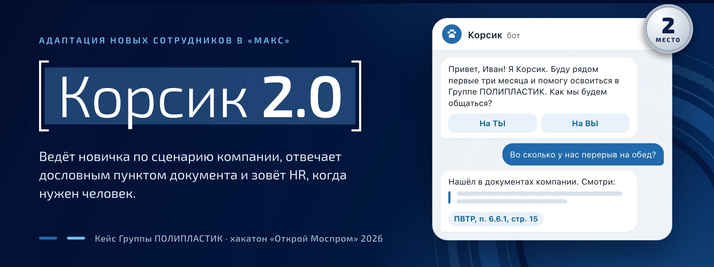](https://mosprom-polyplast.rapira-cloud.ru)

ИИ-ассистент адаптации новых сотрудников в мессенджере «МАКС» и панель для HR и руководителей прямо внутри «МАКС». Решение кейса ООО «Группа ПОЛИПЛАСТИК», хакатон «Открой Моспром», 2026.

**[Презентация](https://mosprom-polyplast.rapira-cloud.ru)** · **[Критерии кейса](#критерии-кейса-где-это-видно)** · [Запуск](#запуск-env-и-одна-команда) · [Проверить руками](#проверить-руками) · [Маршрут сотрудника по дням](eval/journey/gtp-operator.md) · [Разработчикам](app/CONTRACTS.md)

        

> [!IMPORTANT]
> **Корсик отвечает только по документам компании и ничего не придумывает.** На вопрос новичка он присылает пункт документа слово в слово и указывает источник («ПВТР, п. 6.5.2, стр. 15»). Нейросеть только выбирает подходящий пункт из пяти найденных, свой текст она не пишет. Если ответа в документах нет, бот честно говорит «не знаю» и передаёт вопрос HR. Ответ HR можно одной кнопкой добавить в базу, и в следующий раз бот ответит сам.


https://github.com/user-attachments/assets/b3e20e35-e33e-46ab-9418-0058350a1c9c


> [!TIP]
> **Проверить за 2 минуты.** Написать боту в «МАКС»: [@se14753003_bot](https://max.ru/se14753003_bot), он отвечает, пока запущен демо-стенд. [Презентация](https://mosprom-polyplast.rapira-cloud.ru) с калькулятором эффекта, [скриншоты бота и панели](#как-выглядит-продукт), [маршрут оператора по дням](eval/journey/gtp-operator.md): его генерирует сквозной тест по настоящему коду бота. Запустить у себя: [пять команд](#запуск-env-и-одна-команда), панель на встроенных демо-данных открывается без бэкенда по адресу `http://localhost:5173/?mocks=1`.

## Было и стало

| | Было: «Корсик» в Telegram | Стало: Корсик 2.0 в «МАКС» |
| --- | --- | --- |
| Мессенджер | Telegram, небезопасный для корпоративного контура | «МАКС»: бот и панель HR в одном приложении |
| Сценарий | 68 шагов кнопками | Тот же xlsx-сценарий целиком, по расписанию с учётом площадки и производственного календаря |
| Свой вопрос новичка | Заглушка с советом обратиться к рекрутеру | Дословный пункт документа с источником или честное «не знаю» и вопрос HR |
| Ответы в опросах | HR читает вручную | Красные флаги сразу в HR-группу, с согласия новичка ИИ размечает тему и настроение |
| Руководитель | Не участвует | Напоминания провести встречу и кнопка «Провёл» |
| Руководитель HR | Узнаёт о проблеме по заявлению на увольнение | Зоны риска с причинами и еженедельная сводка |
| Новая площадка или регламент | Нужен программист | HR сам загружает таблицу и документы в панели |

## Критерии кейса: где это видно

Сильнее всего, на наш взгляд, решение основной проблемы, новаторский подход к ответам и UX без спама.

| Критерий | Что сделали | Чем проверить |
| --- | --- | --- |
| **Прототип** | Бот и панель работают внутри «МАКС» для всех четырёх ролей кейса | [Скриншоты](#как-выглядит-продукт), `make test`, [маршрут сотрудника](eval/journey/gtp-operator.md) |
| **Решение основной проблемы** | Telegram заменён на «МАКС», бот понимает свободный текст и разбирает ответы в опросах | 42 из 50 ответов верным пунктом, красные флаги 0,96 |
| **Разработка и внедрение** | Пилот на одном заводе, сценарий и документы загружает HR без программиста | 68 из 68 шагов xlsx импортируются, [расчёт эффекта](#эффект-для-компании) |
| **Новаторские идеи** | Ответ только дословным пунктом; «не знаю», вопрос HR, ответ HR в базу; все модели в закрытом контуре | 15 из 15 личных вопросов ушли HR без ИИ |
| **UI/UX** | Бот не засыпает сообщениями: где можно, правит уже отправленное. У каждой роли свой экран | За 92 дня 39 новых сообщений и ещё 46 правок отправленных |
| **Второстепенные проблемы** | HR не читает тексты вручную, руководитель в процессе, база обновляется без кода | За 92 дня у оператора в HR-группу пришло 4 события, все по делу |
| **Аналитика** | Разобрали аудиторию, путь новичка и аналоги на рынке | [Кому и зачем](#кому-и-зачем) |

## Четыре главные возможности

| **01 · Сценарий компании в «МАКС»** | **02 · Ответ дословным пунктом** |
| --- | --- |
| Все **68 шагов** xlsx-сценария импортируются. Новичок получает общие шаги и шаги своей площадки и формата работы по расписанию: производственный календарь РФ, часовой пояс. Несколько шагов подряд приходят одним сообщением. | Гибридный поиск находит пункт, модель выбирает из найденных. В каждом ответе источник и кнопка «Связаться с HR». Личные вопросы («не пришла зарплата») уходят HR сразу, без ИИ. [Как мерили качество](eval/RESULTS.md). |
| **03 · Сигналы и обращения HR** | **04 · Аналитика для руководителя HR** |
| Красные флаги (охрана труда, травля, угрозы, здоровье) ловятся в любом сообщении. Обращение сразу уходит в HR-группу «МАКС», HR отвечает из панели, ответ приходит новичку в чат. [Точность флагов](eval/flags/RESULTS.md). | Новички в зоне риска с понятной причиной («оценка упала с 9 до 5», «встреча просрочена»), темы трудностей, воронка этапов, еженедельная сводка картинкой. |

## Как выглядит продукт

### Бот в «МАКС»

Скриншоты с телефона, тестовый аккаунт. Текст пункта регламента размыт: документы компании внутренние.

<table>
  <tr>
    <td width="33%" valign="top"><b>Знакомство</b></td>
    <td width="33%" valign="top"><b>Ответ дословным пунктом</b></td>
    <td width="33%" valign="top"><b>Честное «не знаю»</b></td>
  </tr>
  <tr>
    <td valign="top"><a href="media/bot/start.webp">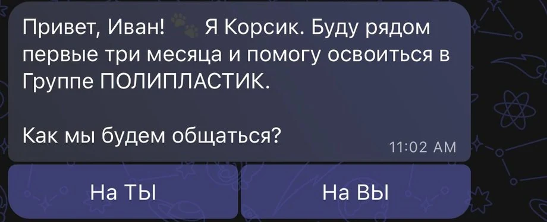</a></td>
    <td valign="top"><a href="media/bot/answer.webp">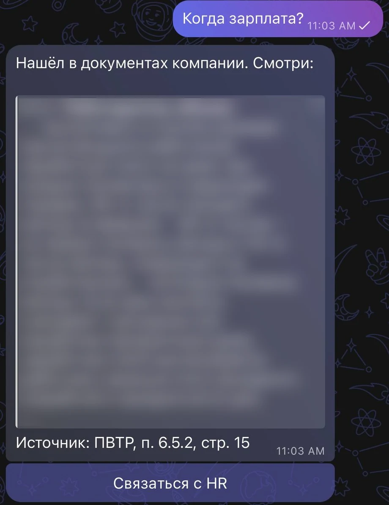</a></td>
    <td valign="top"><a href="media/bot/dontknow.webp">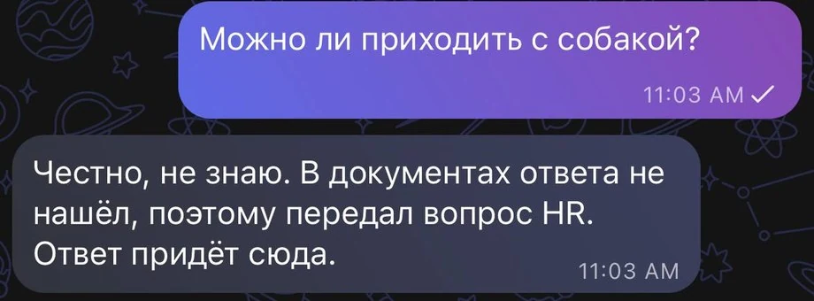</a></td>
  </tr>
  <tr>
    <td valign="top">Знакомство идёт одним сообщением: после каждой кнопки оно меняется на месте.</td>
    <td valign="top">Пункт целиком, источник со страницей и кнопка «Связаться с HR», если ответ не подошёл.</td>
    <td valign="top">Ответа в документах нет: бот не выдумывает, а передаёт вопрос HR. Ответ придёт в этот же чат.</td>
  </tr>
</table>

### Панель в «МАКС» для HR и руководителей

> [!NOTE]
> Скриншоты на демо-данных: все люди и ответы вымышленные.

<table>
  <tr>
    <td width="33%" valign="top"><b>HR видит всех новичков</b></td>
    <td width="33%" valign="top"><b>Карточка новичка</b></td>
    <td width="33%" valign="top"><b>Обращение с красным флагом</b></td>
  </tr>
  <tr>
    <td valign="top"><a href="media/screens/hr-employees.webp">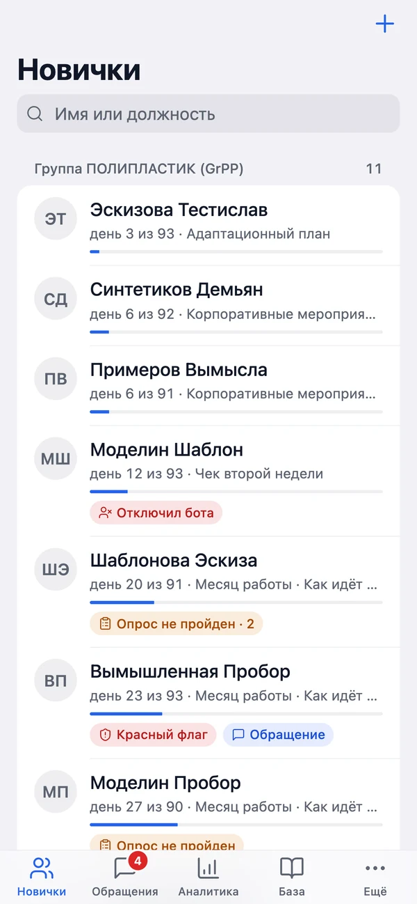</a></td>
    <td valign="top"><a href="media/screens/hr-employee-card.webp">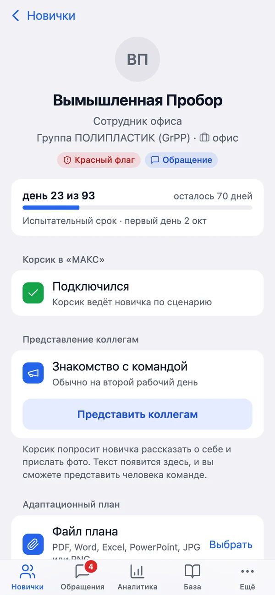</a></td>
    <td valign="top"><a href="media/screens/hr-ticket.webp">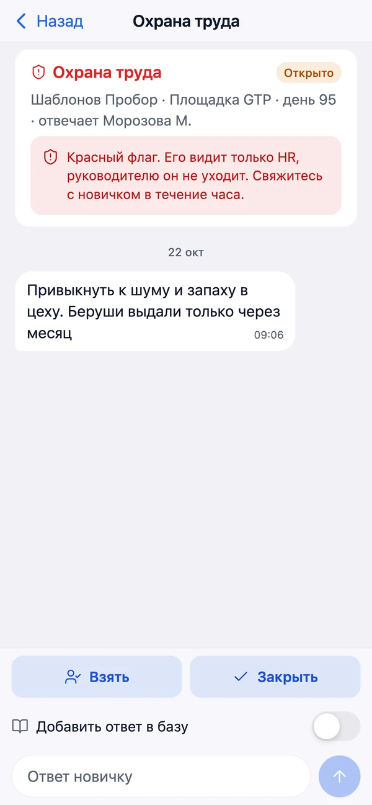</a></td>
  </tr>
  <tr>
    <td valign="top">Площадки, день адаптации, этап и метки: красный флаг, непройденный опрос, отключил бота.</td>
    <td valign="top">Где новичок по сценарию, подключился ли к боту, кнопка «Представить коллегам».</td>
    <td valign="top">Красный флаг видит только HR. Хороший ответ можно добавить в базу знаний.</td>
  </tr>
  <tr>
    <td width="33%" valign="top"><b>Аналитика руководителя HR</b></td>
    <td width="33%" valign="top"><b>Руководитель подразделения</b></td>
    <td width="33%" valign="top"><b>Сводка раз в неделю</b></td>
  </tr>
  <tr>
    <td valign="top"><a href="media/screens/head-analytics.webp">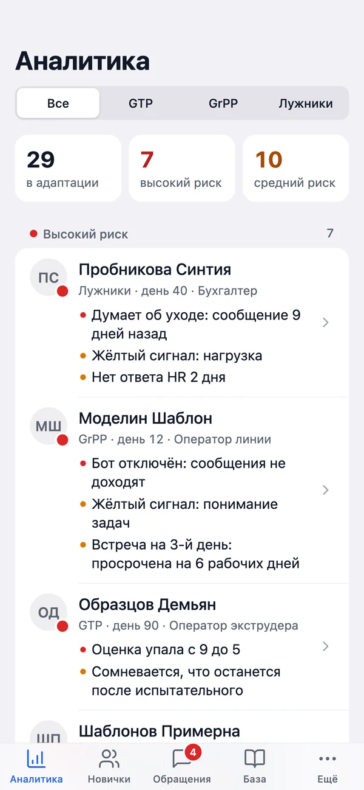</a></td>
    <td valign="top"><a href="media/screens/manager.webp">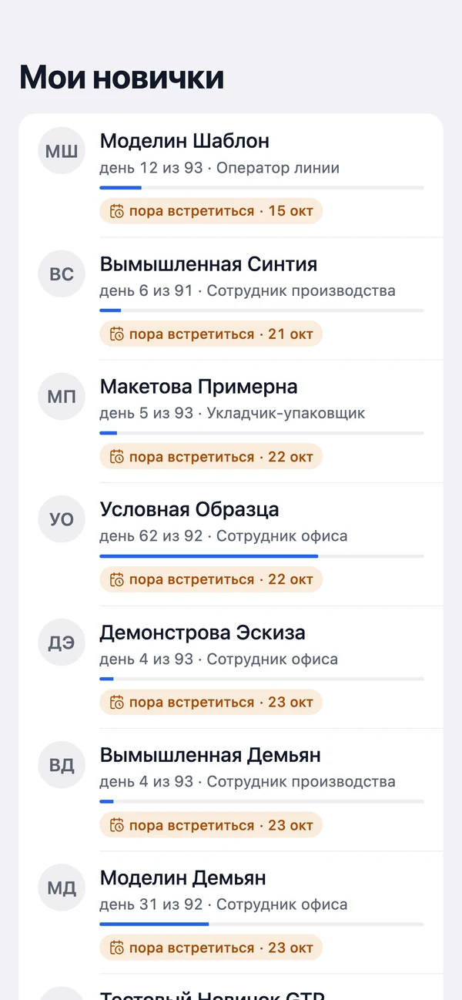</a></td>
    <td valign="top"><a href="app/reports/example.png">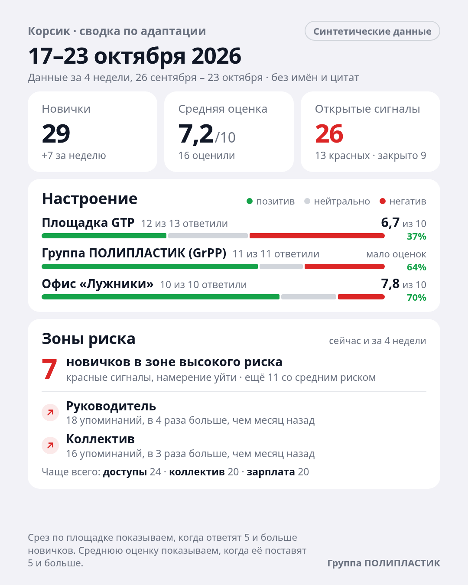</a></td>
  </tr>
  <tr>
    <td valign="top">Зоны риска по площадкам, у каждого человека причина.</td>
    <td valign="top">Только свои новички и встречи. Ответы опросов и обращения руководитель не видит.</td>
    <td valign="top">Картинка приходит руководителю HR в «МАКС»: настроение, частые темы, зоны риска.</td>
  </tr>
</table>

<details>
<summary><strong>Все возможности по ролям</strong></summary>

**Новый сотрудник (бот в «МАКС»)**
- Подключается по ссылке или QR из оффера. Знакомство одним сообщением: «ты» или «вы», согласие на сопровождение, отдельное согласие на ИИ-разбор ответов.
- Задаёт вопрос своими словами и получает дословный пункт документа с источником. Личные вопросы сразу уходят HR.
- Проходит опросы из ТЗ: 1-й и 3-й день, 2 недели, адаптационный план, 2 месяца, конец испытательного. При оценке ниже 8 или ответе «нет» бот спрашивает «что мешает?». Если опрос не пройден, напоминает на следующий рабочий день и через день.
- В первый рабочий день бот сам добавляет новичка в чаты команды. Если не пустили настройки приватности, присылает ссылки. С согласия новичка публикует его рассказ о себе в чате команды.

**HR-менеджер (панель в «МАКС» и HR-группа)**
- Список новичков по площадкам: день, этап, непройденные опросы, обращения, подключился ли.
- Заводит новичка за минуту и получает ссылку и QR для оффера.
- Отвечает на обращения из панели. Хороший ответ после подтверждения попадает в базу знаний.
- Обновляет базу без программиста: загружает PDF, PPTX и новый xlsx сценария, в том числе с новой площадкой.

**Руководитель подразделения**
- Напоминание «проведи встречу» на 3-й, 30-й, 60-й день и перед концом испытательного, с кнопкой «Провёл».
- Экран «Мои новички».

**Руководитель HR**
- Экран «Аналитика»: зоны риска с причинами, темы трудностей с динамикой и обезличенными цитатами, воронка этапов.
- Еженедельная сводка картинкой. Срезы показываются, только если ответили 5 и больше новичков.

**Анализ обратной связи**
- Красные флаги ловятся словарём в любом сообщении и в любом состоянии диалога. Новичок получает ответ «увидит только HR» и, если нужно, номер 112.
- С согласия новичка ИИ определяет у свободного ответа тему, настроение и цитату-доказательство. Тексты о здоровье в модель не отправляются.

</details>

## 92 дня оператора производства

Сквозной тест проводит оператора производства на площадке GTP от приглашения до конца испытательного срока по настоящему коду бота. Сколько сообщений получил каждый:

| Этап | Новичку: новых и правок | HR-группе | Руководителю |
| --- | --- | --- | --- |
| За 3 дня до выхода: приглашение и знакомство | 3 и 4 | 0 | 0 |
| Накануне выхода | 2 и 1 | 0 | 0 |
| День 1: первый рабочий день и свой вопрос | 11 и 5 | 1 | 1 |
| День 2: представление коллегам | 3 и 1 | 1 | 0 |
| День 3: опрос, встреча, тревожное сообщение, ответ HR | 5 и 4 | 2 | 1 |
| День 15: чек двух недель | 2 и 10 | 0 | 0 |
| С 30-го по 87-й день | 8 и 7 | 0 | 3 |
| День 92: итоговый опрос и прощание | 5 и 14 | 0 | 0 |
| **Итого** | **39 и 46** | **4** | **5** |

Подробно по дням, с текстами сообщений и кнопками: [eval/journey/gtp-operator.md](eval/journey/gtp-operator.md).

## Качество

Цифры получены на эталонных и синтетических данных и пересчитываются командами `make eval` и `make eval-flags`.

| Что проверяем | Результат |
| --- | --- |
| Верный пункт документа в первой пятёрке поиска | **50 из 50** (поиск по словам BM25: 34 из 50) |
| Верный пункт на первом месте | **38 из 50** (BM25: 21 из 50) |
| Бот ответил верным пунктом | **42 из 50** |
| Личные вопросы ушли HR без ИИ | **15 из 15** |
| Бот ответил сам, без HR (все 73 вопроса эталона) | **64%** |
| Красный флаг найден: точность и полнота | **0,96 / 0,96** |
| Автотесты (pytest), покрытие кода | **888**, 89% |

<details>
<summary><strong>Как считали</strong></summary>

- Эталон: 73 вопроса (50 по документам, 15 личных, 8 вне базы), подробности в [eval/RESULTS.md](eval/RESULTS.md). Пороги подобраны на этом же эталоне, поэтому цифры оптимистичные.
- Пункт на прогоне выбирала модель GigaChat по API. Локальную модель на эталоне пока не мерили.
- Флаги: 136 синтетических ответов, [eval/flags/RESULTS.md](eval/flags/RESULTS.md).
- В чистом клоне без xlsx сценария и документов компании часть тестов пропускается: они проверяют работу с этими файлами.

</details>

## ИИ работает в закрытом контуре

Все модели решения можно поставить на сервер компании. ИИ делает две небольшие задачи: выбирает подходящий пункт из найденных и разбирает свободные ответы в опросах. Всё остальное работает без модели.

| Задача | Чем делаем | Где работает |
| --- | --- | --- |
| Поиск по документам | bge-m3 (открытые веса) и полнотекстовый поиск Postgres | всегда на сервере компании |
| Выбрать пункт, разобрать ответ опроса | открытая модель через OpenAI-совместимый API, например GigaChat 3 Lightning (веса открыты под MIT) | на сервере компании |
| Личные вопросы, красные флаги, маскирование ФИО и телефонов | правила и словари | всегда локально |

Модель подключается настройками в `.env`: `LLM_PROVIDER=openai`, `LLM_BASE_URL=http://<сервер модели>/v1`, `LLM_MODEL=<имя модели>`. Если модель недоступна, бот всё равно работает: при уверенном поиске отвечает пунктом сам, иначе передаёт вопрос HR.

<details>
<summary><strong>Демо-стенд и сервер без интернета</strong></summary>

- Демо-стенд ходит в облачный GigaChat (`LLM_PROVIDER=gigachat`, `GIGACHAT_CREDENTIALS`, `GIGACHAT_SCOPE`, `GIGACHAT_MODEL`): у команды нет сервера с видеокартой.
- Модель эмбеддингов кладётся в том `models` заранее (один раз запустить `make kb` там, где есть интернет, и перенести том) или указывается локальный путь: `EMBEDDING_MODEL=/models/bge-m3`.
- В `.env` добавить `HF_HUB_OFFLINE=1`, чтобы приложение не обращалось к HuggingFace.
- Наружу остаётся только Bot API «МАКС»: без него мессенджер не работает.

</details>

## Эффект для компании

Расчёт на консервативных допущениях, их стоит заменить цифрами компании. В презентации это калькулятор, параметры можно двигать.

| Допущение | Значение |
| --- | --- |
| Новичков в год | 500 (допущение команды) |
| Уходят на испытательном сроке | 15% (допущение команды) |
| Удержим дополнительно | 3 п. п., то есть 15 человек в год (допущение команды) |
| Зарплата | 105 000 ₽ в месяц (допущение команды) |
| Стоимость замены сотрудника | 21% годового дохода ([оценка АНКОР](https://www.dp.ru/a/2010/09/30/Vo_skolko_obhodits_zamen)) |
| Вопросов к HR на новичка | 10, по 5 минут на ответ (допущение команды) |
| Бот отвечает сам | 64%, как на эталоне |

| Результат | В год |
| --- | --- |
| Экономия на замене людей: 15 × 105 000 × 12 × 0,21 | **≈ 4 млн ₽** (3 969 000 ₽) |
| Время HR: бот сам ответит на 3 200 вопросов | **267 часов** |

Кейс ставит цель снизить рутинную нагрузку на HR до 70%. На эталоне бот сам закрыл 64% вопросов, а разбор ответов в опросах HR больше не делает вручную.

## Кому и зачем

- **Рабочий на производстве.** Нет рабочей почты и компьютера, есть телефон с «МАКС». В первые дни ему нужно понять, где пропуск, откуда автобус, когда зарплата и кто наставник. Поэтому всё происходит в мессенджере, а не в портале.
- **HR-менеджер.** Тратит до 40% времени на разбор ответов в опросах и типовые вопросы (по данным кейса). Ему нужны только случаи, где нужен человек.
- **Руководитель подразделения.** Когда руководитель активно участвует в адаптации, сотрудники в 3,4 раза чаще считают её успешной ([Gallup](https://www.gallup.com/workplace/353096/practical-tips-leaders-better-onboarding-process.aspx)). Поэтому бот не заменяет руководителя, а напоминает ему о встречах.
- **Руководитель HR.** Нужно видеть проблему до заявления на увольнение: 40% сотрудников задумывались об уходе в первые месяцы, у 58% из них ожидания не совпали с реальностью ([hh.ru и Edstein, 2024](https://new-retail.ru/novosti/retail/issledovanie_40_sotrudnikov_zadumyvalis_ob_uvolnenii_v_pervye_mesyatsy_raboty/)).

<details>
<summary><strong>Аналоги: 12 ключевых решений на рынке</strong></summary>

| Решение | Что умеет | Чего не хватает для кейса |
| --- | --- | --- |
| Сбер «Пульс» | HR-платформа, ИИ-агент на GigaChat закрывает 86% обращений ([РИАМО](https://riamo.ru/news/obschestvo/ii-agent-sbera-vnutri-hr-platformy-puls-86-voprosov-reshajutsja-agentom/)) | Агент поддерживает саму платформу, а не ведёт новичка по сценарию |
| Personik | HR-бот: сценарии онбординга, ответы по документам, перевод на HR | Разбора ответов опросов и сигналов HR в открытых источниках не нашли |
| Поток, Skillaz, HRChain | Треки адаптации, геймификация | ИИ в основном для подбора, не для адаптации |
| Норникель | Чат-бот адаптации для рабочих без компьютера ([ComNews](https://www.comnews.ru/digital-economy/content/217830/2021-12-08/2021-w49/nornikel-avtomatiziroval-process-adaptacii-personala-baze-sap)) | Кнопочный бот без ИИ |
| Leena AI, Moveworks | ИИ-ответы сотрудникам, от 54 до 88% вопросов без человека (данные вендоров) | Зарубежные решения, без «МАКС» |
| Culture Amp, Viva Glint, Peakon | ИИ-разбор комментариев в опросах | Только опросы, без бота и без сценария адаптации |
| Enboarder | Напоминания руководителю о действиях с новичком | Зарубежный, без «МАКС» |

Ни одно из найденных решений не закрывает всю связку: сценарий адаптации, ответы по документам, разбор ответов, сигналы HR, напоминания руководителю и сводка. Зарубежные лидеры делят её на три разных продукта.

</details>

## Данные и безопасность

- **Ответы только из документов.** Бот цитирует пункт дословно и показывает источник. Вопрос вне базы уходит HR.
- **Маскирование.** Перед вызовом модели ФИО всех сотрудников, телефоны, e-mail и номера документов заменяются метками. Фрагменты с грифом коммерческой тайны и тексты о здоровье в модель не отправляются.
- **Согласия.** ИИ-разбор ответов идёт только с отдельного согласия новичка. Без него всё остальное работает так же.
- **Доступ к панели.** Вход только через «МАКС»: подпись `initData` проверяется по токену бота. Руководитель видит только своих новичков.
- **Демо-данные** синтетические и помечены. Машина времени и другие демо-функции в проде выключены и не работают для живых новичков.
- **Документы заказчика** из `docs/` внутренние и в открытый доступ не выкладываются.

## Запуск: env и одна команда

Нужен Docker (Docker Desktop на Mac, образы собираются и под arm64). Python и Node ставятся в образах.

```bash
cp .env.example .env        # токен бота «МАКС» и ключ GigaChat или адрес своей модели
docker compose up -d --build
make seed                   # демо-данные, все синтетические
make import                 # сценарий из data/raw/korsik_scenario.xlsx
make kb                     # база знаний: документы и статьи сценария
make links                  # ссылки привязки для тестовых новичков и персонала
```

- **xlsx сценария** из материалов кейса положите в `data/raw/korsik_scenario.xlsx`: в git его нет. Или загрузите таблицу в панели, вкладка «База».
- **`make kb`** при первом запуске скачивает модель bge-m3, около 2 ГБ, в том `models`.
- **Без токена «МАКС»** бот не запускается, а API и панель работают.
- **Панель в браузере:** http://localhost:5173. Чтобы открыть её вне «МАКС», поставьте в `.env` `DEV_ALLOW_NO_INIT_DATA=true` (работает только с этой машины). Без бэкенда, на встроенных демо-данных: http://localhost:5173/?mocks=1.
- API: http://localhost:8000/health, Postgres: `localhost:5433`. Миграции применяются при старте `app`.
- Если этот токен бота уже работает на другой машине, поставьте `BOT_ENABLED=false`: два экземпляра мешают друг другу.
- Прочее: `make logs`, `make test`, `make cov`, `make eval`, `make eval-flags`, `make psql`, `make shell`, `make down`.

## Проверить руками

```bash
docker compose ps
curl -fsS http://localhost:8000/health    # {"status":"ok","db":"ok"}
make test
```

1. `make links` и открыть ссылку тестового новичка в «МАКС» на телефоне: пройти знакомство, задать вопрос («во сколько обед?»), попробовать `/hr` и `/food`.
2. В панели «Ещё», раздел «Демо»: перемотать тестового новичка за 2 дня до выхода, на 1, 3, 14, 60 день или конец испытательного. Шаги и опросы этого дня придут в чат сразу.
3. Ответить на обращение из панели: ответ придёт новичку. Посмотреть «Аналитику» и сформировать сводку.

<details>
<summary><strong>Запуск на сервере: свой домен и HTTPS</strong></summary>

Нужны сервер с Docker, поддомен с A-записью на его IP и открытые порты 80 и 443.

```bash
git clone <репозиторий> && cd <каталог>
cp .env.example .env        # токен бота, адрес модели и строка DOMAIN=korsik.example.ru
docker compose -f docker-compose.yml -f docker-compose.prod.yml up -d --build
make import kb              # сценарий и база знаний
make seed                   # только для демо: синтетические данные
```

- Caddy (`deploy/Caddyfile`) сам получает сертификат и отдаёт собранную Mini App и `/api`. Наружу открыты только 80 и 443, база и API без прокси снаружи недоступны.
- Вход в панель только через «МАКС» (`DEV_ALLOW_NO_INIT_DATA=false`), `MINIAPP_URL` выставляется из `DOMAIN`.
- Демо-функции в проде выключены. Для показа на сервере добавьте в `.env` строку `DEMO_ENABLED=true`: перематывать можно только тестовых и синтетических новичков.
- Адрес `https://<DOMAIN>` один раз прописывается у бота на business.max.ru, подробно в [miniapp/README.md](miniapp/README.md).
- Пароль Postgres в `docker-compose.yml` учебный. Наружу база не открыта, но на боевом сервере его стоит сменить.

</details>

## Как устроено

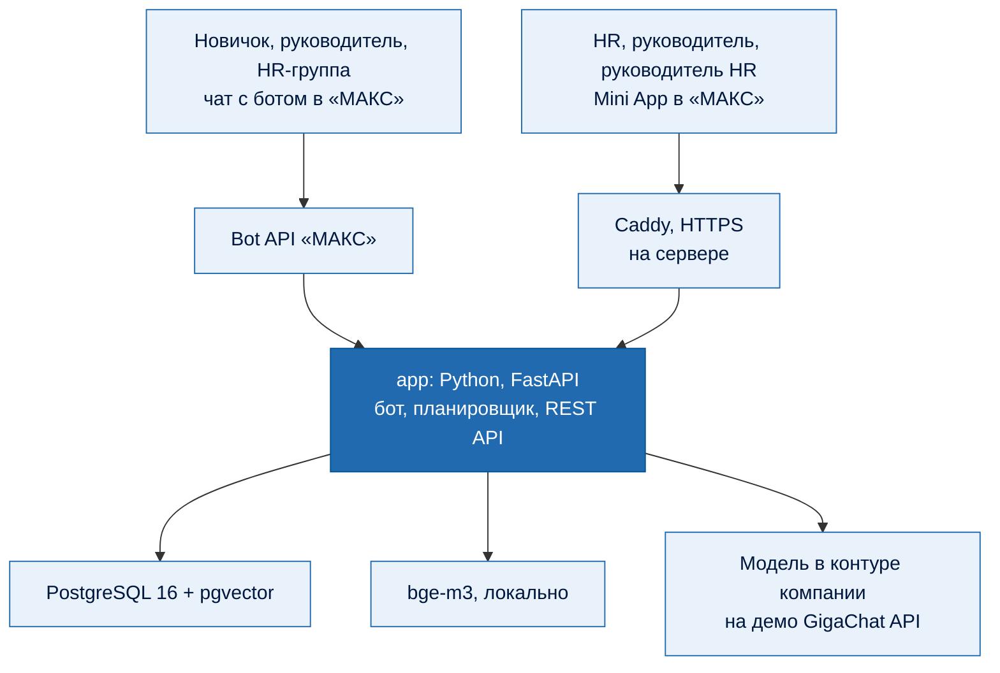

- Модули подключаются к боту через точки расширения (`app/bot/hooks.py`), контракты между модулями описаны в [app/CONTRACTS.md](app/CONTRACTS.md).
- Поиск по базе знаний гибридный: полнотекстовый Postgres и векторный bge-m3, объединение RRF, фильтр по площадке.

<details>
<summary><strong>Карта репозитория</strong></summary>

| Каталог | Что внутри |
| --- | --- |
| [app](app) | Бэкенд: бот, сценарий, опросы, сигналы, база знаний, обращения, чаты, руководитель, сводка, аналитика, API |
| [miniapp](miniapp) | Mini App для HR и руководителей (React, TypeScript) |
| [config](config) | Опросы, словари флагов и синонимов, пороги, производственный календарь |
| [assets](assets) | Картинки и файлы шагов сценария |
| [seed](seed) | Синтетические демо-данные |
| [eval](eval) | Эталон вопросов, оценка качества, маршрут сотрудника |
| [tests](tests) | Автотесты, включая сквозной |
| [deploy](deploy), `docker-compose*.yml` | Запуск локально и на сервере |
| [media](media) | Картинки для этого README, исходник анимации на HyperFrames в `media/anim` |
| [plan.md](plan.md), [dev-plan.md](dev-plan.md) | Что делаем и план разработки |

</details>

## Границы пилота и что дальше

- **Цифры качества оптимистичные:** пороги поиска подобраны на том же эталоне, на котором мерили. На пилоте их надо перепроверить на вопросах настоящих новичков.
- **Чаты команды** заработают, когда HR добавит бота админом в группы «МАКС»: без этого бот не может добавлять туда новичков.
- **Что дальше:** пилот на одном заводе, затем остальные площадки Группы. Из отзывов экспертов в очереди баллы и ачивки за шаги адаптации и Корсик как персонаж в стиле компании.

Команда «Рапира Клауд», хакатон «Открой Моспром», 2026.
