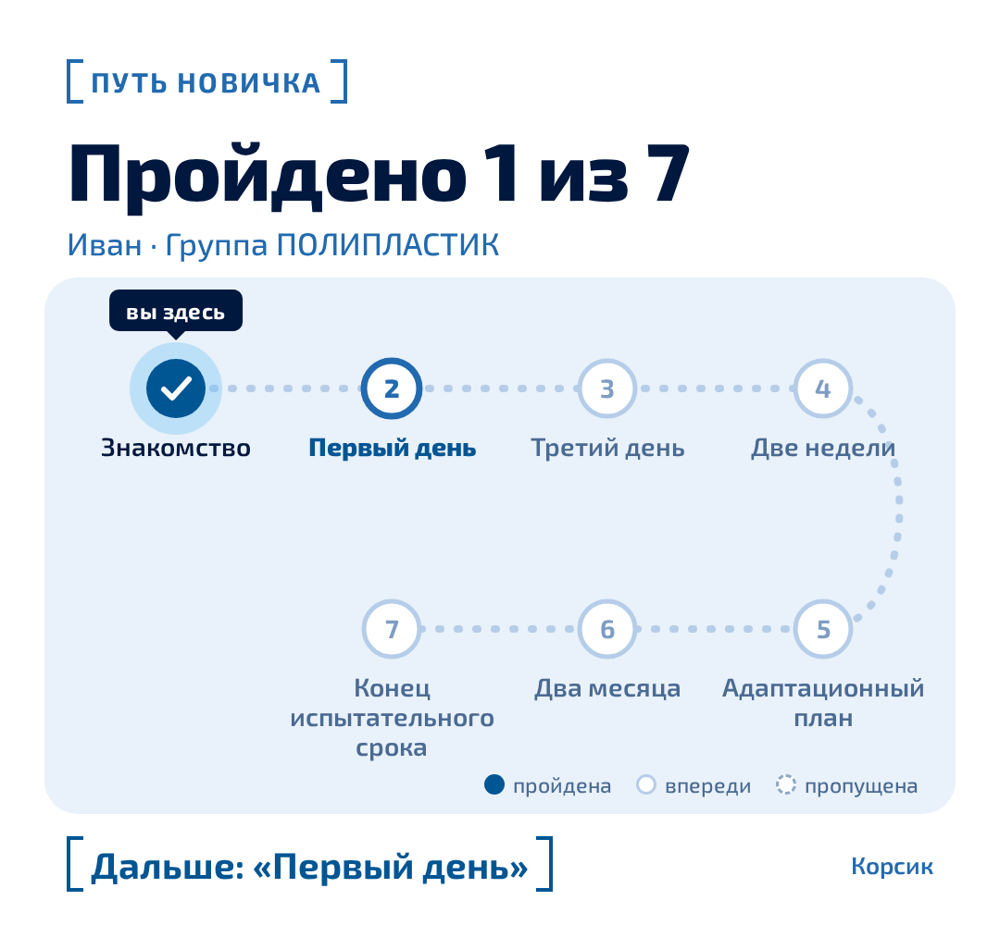
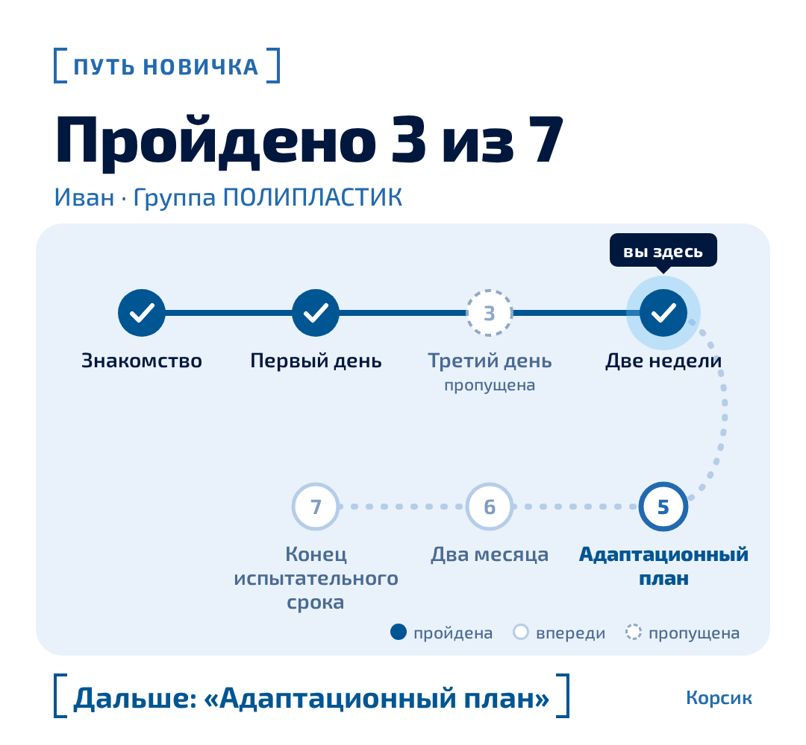
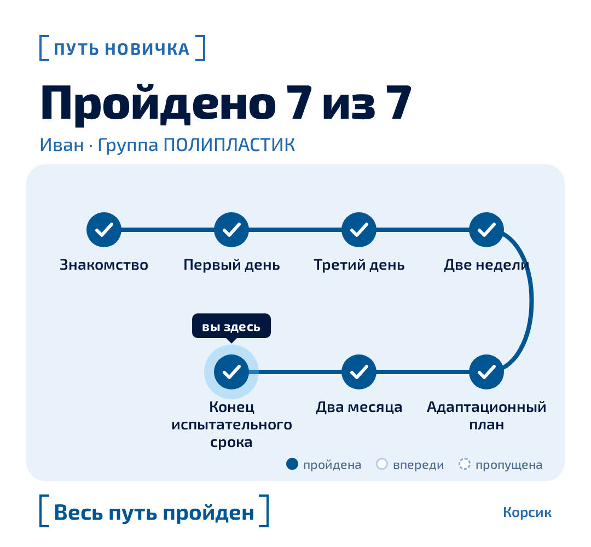
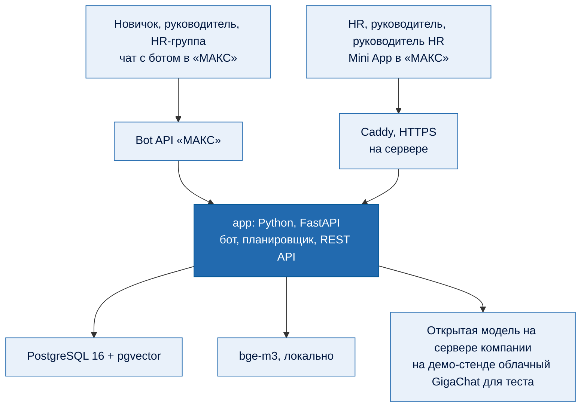

# Корсик 2.0

[](https://mosprom-polyplast.rapira-cloud.ru)

ИИ-ассистент адаптации новых сотрудников в мессенджере «МАКС» и панель для HR и руководителей там же. Решение кейса ООО «Группа ПОЛИПЛАСТИК», хакатон «Открой Моспром», 2026.

**Сайт проекта: [mosprom-polyplast.rapira-cloud.ru](https://mosprom-polyplast.rapira-cloud.ru)**, там основная презентация, демо-видео и исследование.

        

> [!IMPORTANT]
> **Корсик отвечает только по документам компании и ничего не придумывает.** На вопрос новичка он присылает пункт документа слово в слово и указывает источник («ПВТР, п. 6.5.2, стр. 15»). Нейросеть только выбирает подходящий пункт из пяти найденных. Если ответа в документах нет, бот честно говорит «не знаю» и передаёт вопрос HR. Ответ HR можно одной кнопкой добавить в базу, и в следующий раз бот ответит сам.


[](https://mosprom-polyplast.rapira-cloud.ru/video/demo.mp4)

Демо-видео 1:20, экран пополам: слева новичок, справа HR и руководители. Нажмите на картинку, видео откроется в браузере.


> [!TIP]
> **Как попробовать Корсика** (бот отвечает, пока запущен демо-стенд):
> 1. Вступить в две группы «МАКС» из таблицы «Ссылки» ниже, чтобы видеть, что присылает бот. Сам добавить человека в группу бот не может.
> 2. Открыть бота [@se14753003_bot](https://max.ru/se14753003_bot) в «МАКС» или отсканировать QR на сайте проекта. Набрать `/demo` и выбрать «Новичок GTP».
> 3. Пройти знакомство, затем `/demo`, «Перемотать день…», «1». Придут сообщения первого рабочего дня и ссылка на чат команды.
> 4. Спросить своими словами: «Когда зарплата?» или «Можно ли приходить с собакой?».
> 5. Написать жалобу, например «мастер угрожает уволить, если пожалуюсь». Карточка сразу придёт в HR-группу.
>
> Запустить у себя: шесть команд из раздела «Запуск в Docker Compose». Панель на встроенных демо-данных открывается без бэкенда: `http://localhost:5173/?mocks=1`.

## Ссылки

| Что | Ссылка | Зачем |
| --- | --- | --- |
| **Сайт проекта** | [mosprom-polyplast.rapira-cloud.ru](https://mosprom-polyplast.rapira-cloud.ru) | Всё в одном месте: основная презентация, демо-видео, подробное исследование, как попробовать |
| Бот Корсик в «МАКС» | [@se14753003_bot](https://max.ru/se14753003_bot) | Бот новичка: знакомство, шаги сценария, ответы по документам, опросы. `/demo` переключает роль: новичок, HR, руководитель, руководитель HR |
| HR-группа «ПОЛИПЛАСТИК \| HR-обращения» | [вступить](https://max.ru/join/d2VM-Ov1Z0DLdaLWsnDxEa7uFdu8B0i1v8CixOxsBTI) | Карточки красных флагов и вопросы, на которые бот не ответил сам. Отвечать могут HR, рекрутер и руководитель HR. Новичков бот сюда не зовёт |
| Чат команды «Газтрубпласт \| новички» | [вступить](https://max.ru/join/oiM6wJbQSsY0u1aO33HDcjbwfiyVolcWuHCEDEOXv_0) | Чат новичков площадки GTP. В первый рабочий день бот присылает новичку ссылку сюда, а на второй с его согласия публикует рассказ о нём: «Знакомьтесь, это …» |

## Было и стало

| | Было: «Корсик» в Telegram | Стало: Корсик 2.0 в «МАКС» |
| --- | --- | --- |
| Мессенджер | Telegram, небезопасный для корпоративного контура | «МАКС»: бот и панель HR в одном приложении |
| Сценарий | 68 шагов кнопками | Тот же xlsx-сценарий целиком, по расписанию с учётом площадки и производственного календаря |
| Свой вопрос новичка | Заглушка с советом обратиться к рекрутеру | Дословный пункт документа с источником или честное «не знаю» и вопрос HR |
| Ответы в опросах | HR читает вручную | Красные флаги сразу в HR-группу, с согласия новичка ИИ размечает тему и настроение |
| Руководитель | Не участвует | Напоминания провести встречу и кнопка «Провёл» |
| Руководитель HR | Узнаёт о проблеме по заявлению на увольнение | Зоны риска с причинами и еженедельная сводка |
| Новая площадка или регламент | Нужен программист | HR сам загружает таблицу и документы в панели |

## Критерии кейса: где это видно

Сильнее всего, на наш взгляд, у нас получились решение основной проблемы, новаторский подход к ответам и UX без спама.

| Критерий | Что сделали | Чем проверить |
| --- | --- | --- |
| **Прототип** | Бот и Mini App работают внутри «МАКС» для всех четырёх ролей кейса. Демо-режим `/demo`: в одном боте можно стать новичком, HR, руководителем или руководителем HR, перемотать дни адаптации и сбросить прогресс | живой бот [@se14753003_bot](https://max.ru/se14753003_bot), скриншоты ниже, маршрут сотрудника за 92 дня |
| **Решение основной проблемы** | Telegram заменён на «МАКС». Бот понимает свободный текст: отвечает дословным пунктом документа с источником, разбирает ответы в опросах (тема, настроение) с согласия новичка, ловит красные флаги в любом сообщении | 42 из 50 ответов верным пунктом, красные флаги: точность и полнота 0,96 (24 из 25) |
| **Разработка и внедрение** | HR загружает в панели тот же xlsx, что был у Telegram-бота: сценарий не переписан в код. Шаги идут по производственному календарю РФ с учётом часового пояса площадки. Запуск одной командой в Docker Compose, пилот на одном заводе | 68 из 68 шагов xlsx импортируются, 975 автотестов, покрытие 89 %, расчёт эффекта ниже |
| **Новаторские идеи** | Ответ только дословным пунктом, без пересказа; «не знаю», вопрос HR, ответ HR одной кнопкой в базу. Личные вопросы уходят HR мимо нейросети, ФИО и телефоны скрываются до вызова модели. «Путь новичка»: опросы стали картой из 7 вех, механики взяты из исследований | 15 из 15 личных вопросов ушли HR без ИИ, раздел «Путь новичка» |
| **UI/UX** | Вопрос можно надиктовать голосом: удобно у станка, когда руки заняты. Бот не засыпает сообщениями: знакомство идёт одним сообщением, где можно, бот правит уже отправленное. Mini App с отдельным экраном для каждой роли. Карточка пути приходит в том же «спасибо» после опроса | За 92 дня 39 новых сообщений и 53 правки уже отправленных |
| **Второстепенные проблемы** | HR не разбирает опросы вручную. Руководитель получает напоминания о встречах на 3-й, 30-й, 60-й день и перед концом испытательного срока, отмечает «Провёл». Зоны риска видны до увольнения. Базу знаний и сценарий HR обновляет сам, без программиста | За 92 дня у оператора в HR-группу пришло 5 событий: 4 по ходу адаптации и одно в конце, вручить мерч |
| **Аналитика** | Руководитель HR видит зоны риска с понятной причиной («оценка упала с 9 до 5»), темы трудностей и воронку этапов, раз в неделю получает сводку картинкой в личные сообщения «МАКС». Срезы показываются, только если ответили 5 человек и больше. Разобрали аудиторию, 12 аналогов на рынке и экономику | разделы «Кому и зачем» и «Эффект для компании», пример сводки ниже |

## Четыре главные возможности

| **01 · Сценарий компании в «МАКС»** | **02 · Ответ дословным пунктом** |
| --- | --- |
| Все **68 шагов** xlsx-сценария импортируются. Новичок получает общие шаги и шаги своей площадки и формата работы по расписанию: производственный календарь РФ, часовой пояс. Несколько шагов подряд приходят одним сообщением. | Гибридный поиск находит пункт, модель выбирает из найденных. В каждом ответе источник и кнопка «Связаться с HR». Вопрос можно не печатать, а надиктовать: голосовое распознаётся на сервере. Личные вопросы («не пришла зарплата») уходят HR сразу, без ИИ. |
| **03 · Сигналы и обращения HR** | **04 · Аналитика для руководителя HR** |
| Красные флаги (охрана труда, травля, угрозы, здоровье) ловятся в любом сообщении. Обращение сразу уходит в HR-группу «МАКС», HR отвечает из панели, ответ приходит новичку в чат. | Новички в зоне риска с понятной причиной («оценка упала с 9 до 5», «встреча просрочена»), темы трудностей, воронка этапов, еженедельная сводка картинкой. |

## Путь новичка: геймификация без рейтингов

Бот показывает 92 дня испытательного срока как путь из 7 вех: знакомство засчитывается сразу, дальше 6 пульс-опросов из сценария. Прошёл опрос, значит прошёл веху. Карточка пути приходит в том же сообщении «спасибо», лишних сообщений бот не присылает.

<table>
  <tr>
    <td width="33%" valign="top"></td>
    <td width="33%" valign="top"></td>
    <td width="33%" valign="top"></td>
  </tr>
</table>

| Механика | Почему так |
| --- | --- |
| Карта пути, первая веха засчитана сразу | Близкая цель ускоряет: интервалы между действиями короче на 20% ([Kivetz et al. 2006](https://business.columbia.edu/sites/default/files-efs/pubfiles/1200/goalgradient.pdf)) |
| Одна и та же веха за любой ответ, включая «плохо» | Поощрение повышает шанс дойти опрос до конца в 1,27 раза ([Göritz 2006](https://www.ijis.net/ijis1_1/ijis1_1_goeritz_pre.html)), а награда за факт ответа не толкает отвечать «как надо» |
| В конце пути HR-группе: «можно вручить полезный мерч», новичку заранее не говорим | Неожиданная награда не снижает интерес (d = 0,01), ожидаемая снижает (d = −0,36) ([Deci, Koestner & Ryan 1999](https://leeds-faculty.colorado.edu/dahe7472/deci%201999.pdf)). Подарок в натуре до 4 000 ₽ в год не облагается НДФЛ |
| Без рейтингов, серий «заходи каждый день» и «аватара настроения» | Мониторинг работников не повышает результат и повышает стресс, 94 выборки ([Ravid et al. 2023](https://www.gwern.net/doc/sociology/technology/2022-ravid.pdf)); настроение из ответов близко к данным о здоровье (ст. 10 152-ФЗ) |

Путь видит только сам новичок, руководитель не видит ничего. Выключается флагом `PATH_ENABLED`. Код: `app/path`.

## Как выглядит продукт

### Бот в «МАКС»

Скриншоты с телефона, тестовый аккаунт. Текст пункта регламента размыт: документы компании внутренние.

<table>
  <tr>
    <td width="33%" valign="top"><b>Знакомство</b></td>
    <td width="33%" valign="top"><b>Ответ дословным пунктом</b></td>
    <td width="33%" valign="top"><b>Честное «не знаю»</b></td>
  </tr>
  <tr>
    <td valign="top"></td>
    <td valign="top"></td>
    <td valign="top"></td>
  </tr>
  <tr>
    <td valign="top">Знакомство идёт одним сообщением: после каждой кнопки оно меняется на месте.</td>
    <td valign="top">Пункт целиком, источник со страницей и кнопка «Связаться с HR», если ответ не подошёл.</td>
    <td valign="top">Ответа в документах нет: бот не выдумывает, а передаёт вопрос HR. Ответ придёт в этот же чат.</td>
  </tr>
</table>

### Панель в «МАКС» для HR и руководителей

> [!NOTE]
> Скриншоты на демо-данных: все люди и ответы вымышленные.

<table>
  <tr>
    <td width="33%" valign="top"><b>HR видит всех новичков</b></td>
    <td width="33%" valign="top"><b>Карточка новичка</b></td>
    <td width="33%" valign="top"><b>Обращение с красным флагом</b></td>
  </tr>
  <tr>
    <td valign="top"></td>
    <td valign="top"></td>
    <td valign="top"></td>
  </tr>
  <tr>
    <td valign="top">Площадки, день адаптации, этап и метки: красный флаг, непройденный опрос, отключил бота.</td>
    <td valign="top">Где новичок по сценарию, подключился ли к боту, кнопка «Представить коллегам».</td>
    <td valign="top">Красный флаг видит только HR. Хороший ответ можно добавить в базу знаний.</td>
  </tr>
  <tr>
    <td width="33%" valign="top"><b>Аналитика руководителя HR</b></td>
    <td width="33%" valign="top"><b>Руководитель подразделения</b></td>
    <td width="33%" valign="top"><b>Сводка раз в неделю</b></td>
  </tr>
  <tr>
    <td valign="top"></td>
    <td valign="top"></td>
    <td valign="top"></td>
  </tr>
  <tr>
    <td valign="top">Зоны риска по площадкам, у каждого человека причина.</td>
    <td valign="top">Только свои новички и встречи. Ответы опросов и обращения руководитель не видит.</td>
    <td valign="top">Картинка приходит руководителю HR в «МАКС»: настроение, частые темы, зоны риска.</td>
  </tr>
</table>

<details>
<summary><strong>Все возможности по ролям</strong></summary>

**Новый сотрудник (бот в «МАКС»)**
- Подключается по ссылке или QR из оффера. Знакомство одним сообщением: «ты» или «вы», согласие на сопровождение, отдельное согласие на ИИ-разбор ответов.
- Задаёт вопрос своими словами и получает дословный пункт документа с источником. Личные вопросы сразу уходят HR.
- Проходит опросы из ТЗ: 1-й и 3-й день, 2 недели, адаптационный план, 2 месяца, конец испытательного. При оценке ниже 8 или ответе «нет» бот спрашивает «что мешает?». Если опрос не пройден, напоминает на следующий рабочий день и через день.
- В первый рабочий день бот присылает новичку ссылку на чат его команды: с 9 сентября «МАКС» не даёт ботам добавлять участников в группы. На второй день, после отмашки рекрутера и с согласия новичка, бот публикует в этом чате его рассказ о себе («Знакомьтесь, это …»).

**HR-менеджер (панель в «МАКС» и HR-группа)**
- Список новичков по площадкам: день, этап, непройденные опросы, обращения, подключился ли.
- Заводит новичка за минуту и получает ссылку и QR для оффера.
- Отвечает на обращения из панели. Хороший ответ после подтверждения попадает в базу знаний.
- Обновляет базу без программиста: загружает PDF, PPTX и новый xlsx сценария, в том числе с новой площадкой.

**Руководитель подразделения**
- Напоминание «проведи встречу» на 3-й, 30-й, 60-й день и перед концом испытательного, с кнопкой «Провёл».
- Экран «Мои новички».

**Руководитель HR**
- Экран «Аналитика»: зоны риска с причинами, темы трудностей с динамикой и обезличенными цитатами, воронка этапов.
- Еженедельная сводка картинкой. Срезы показываются, только если ответили 5 и больше новичков.

**Анализ обратной связи**
- Красные флаги ловятся словарём в любом сообщении и в любом состоянии диалога. Новичок получает ответ «увидит только HR» и, если нужно, номер 112.
- С согласия новичка ИИ определяет у свободного ответа тему, настроение и цитату-доказательство. Тексты о здоровье в модель не отправляются.

</details>

## 92 дня оператора производства

Сквозной тест на настоящем коде бота проводит оператора производства на площадке GTP от приглашения до конца испытательного срока. Сколько сообщений получил каждый:

| Этап | Новичку: новых и правок | HR-группе | Руководителю |
| --- | --- | --- | --- |
| За 3 дня до выхода: приглашение и знакомство | 3 и 5 | 0 | 0 |
| Накануне выхода | 2 и 1 | 0 | 0 |
| День 1: первый рабочий день и свой вопрос | 11 и 6 | 1 | 1 |
| День 2: представление коллегам | 3 и 1 | 1 | 0 |
| День 3: опрос, встреча, тревожное сообщение, ответ HR | 5 и 5 | 2 | 1 |
| День 15: опрос через 2 недели | 2 и 11 | 0 | 0 |
| С 30-го по 87-й день | 8 и 9 | 0 | 3 |
| День 92: итоговый опрос и прощание | 5 и 15 | 1 | 0 |
| **Итого** | **39 и 53** | **5** | **5** |

Подробно по дням, с текстами сообщений и кнопками: [eval/journey/gtp-operator.md](eval/journey/gtp-operator.md).

## Качество

Цифры получены на эталонных и синтетических данных. `make eval-flags` пересчитывает флаги в любой копии, `make eval` повторит цифры ответов только с документами компании и ключом GigaChat.

| Что проверяем | Результат |
| --- | --- |
| Верный пункт документа в первой пятёрке поиска | **50 из 50** (поиск по словам BM25: 34 из 50) |
| Верный пункт на первом месте | **38 из 50** (BM25: 21 из 50) |
| Бот ответил верным пунктом | **42 из 50** |
| Личные вопросы ушли HR без ИИ | **15 из 15** |
| Бот ответил сам, без HR (все 73 вопроса эталона) | **64 %** |
| Красный флаг найден: точность и полнота | **0,96 / 0,96** |
| Автотесты (pytest), покрытие кода | **975**, 89 % |

<details>
<summary><strong>Как считали</strong></summary>

- Эталон: 73 вопроса (50 по документам, 15 личных, 8 вне базы), подробности в [eval/RESULTS.md](eval/RESULTS.md). Пороги подобраны на этом же эталоне, поэтому цифры оптимистичные.
- Пункт на прогоне выбирала модель GigaChat по API. Локальную модель на эталоне пока не мерили.
- Флаги: 136 синтетических ответов, [eval/flags/RESULTS.md](eval/flags/RESULTS.md).
- В чистом клоне без xlsx сценария и документов компании часть тестов пропускается: они проверяют работу с этими файлами.

</details>

## ИИ работает в закрытом контуре

Все модели решения можно поставить на сервер компании. ИИ делает три небольшие задачи: распознаёт голосовые, выбирает подходящий пункт из найденных и разбирает свободные ответы в опросах. Всё остальное работает без модели.

| Задача | Чем делаем | Где работает |
| --- | --- | --- |
| Поиск по документам | bge-m3 (открытые веса) и полнотекстовый поиск Postgres | всегда на сервере компании |
| Распознать голосовое | Whisper small через faster-whisper (открытые веса, MIT), около 5 с на фразу на процессоре | на сервере компании, аудио не сохраняется |
| Выбрать пункт, разобрать ответ опроса | открытая модель, например GigaChat 3 Lightning (веса открыты под MIT), развёрнута у компании | только на сервере компании, в интернет не ходит |
| Личные вопросы, красные флаги, маскирование ФИО и телефонов | правила и словари | всегда локально |

> [!NOTE]
> **Облачный GigaChat стоит только на демо-стенде,** чтобы бота можно было попробовать до установки у заказчика: у команды нет сервера с видеокартой. В пилоте его нет, модель работает в закрытом контуре компании.

Модель подключается настройками в `.env`: `LLM_PROVIDER=openai`, `LLM_BASE_URL=http://<сервер модели>/v1`, `LLM_MODEL=<имя модели>`. Если модель недоступна, бот всё равно работает: при уверенном поиске отвечает пунктом сам, иначе передаёт вопрос HR.

<details>
<summary><strong>Демо-стенд и сервер без интернета</strong></summary>

- Демо-стенд ходит в облачный GigaChat (`LLM_PROVIDER=gigachat`, `GIGACHAT_CREDENTIALS`, `GIGACHAT_SCOPE`, `GIGACHAT_MODEL`).
- Модель эмбеддингов кладётся в том `models` заранее (один раз запустить `make kb` там, где есть интернет, и перенести том) или указывается локальный путь: `EMBEDDING_MODEL=/models/bge-m3`.
- В `.env` добавить `HF_HUB_OFFLINE=1`, чтобы приложение не обращалось к HuggingFace.
- Наружу остаётся только Bot API «МАКС»: без него бот не работает.

</details>

## Эффект для компании

Расчёт на консервативных допущениях, их стоит заменить цифрами компании. В презентации это калькулятор, параметры можно двигать.

| Допущение | Значение |
| --- | --- |
| Новичков в год | 500 (допущение команды) |
| Уходят на испытательном сроке | 15 % (допущение команды) |
| Удержим дополнительно | 3 п. п., то есть 15 человек в год (допущение команды) |
| Зарплата | 105 000 ₽ в месяц (допущение команды) |
| Стоимость замены сотрудника | 21 % годового дохода ([оценка АНКОР](https://www.dp.ru/a/2010/09/30/Vo_skolko_obhodits_zamen)) |
| Вопросов к HR на новичка | 10, по 5 минут на ответ (допущение команды) |
| Бот отвечает сам | 64 %, как на эталоне |

| Результат | В год |
| --- | --- |
| Экономия на замене людей: 15 × 105 000 × 12 × 0,21 | **≈ 4 млн ₽** (3 969 000 ₽) |
| Время HR: бот сам ответит на 3 200 вопросов из 5 000 | **267 часов** (417 без бота, 150 с ботом) |
| Затраты: сервер один раз и поддержка | 1 млн ₽ и 300 тыс. ₽ в год |
| Выгода в первый год | **2,67 млн ₽** |
| Сервер окупается | **за 3,3 месяца** (на одном заводе чуть больше года) |

Кейс ставит цель: до 70 % снижения рутинной нагрузки на HR. На эталоне бот сам ответил на 64 % вопросов, а разбор ответов в опросах HR больше не делает вручную.

## Кому и зачем

- **Рабочий на производстве.** Нет рабочей почты и компьютера, есть телефон с «МАКС». В первые дни ему нужно понять, где пропуск, откуда автобус, когда зарплата и кто наставник. Поэтому всё происходит в мессенджере, а не в портале.
- **HR-менеджер.** Тратит до 40 % времени на разбор ответов в опросах и типовые вопросы (по данным кейса). Ему важно видеть только случаи, где без человека не обойтись.
- **Руководитель подразделения.** Когда руководитель активно участвует в адаптации, сотрудники в 3,4 раза чаще считают её успешной ([Gallup](https://www.gallup.com/workplace/353096/practical-tips-leaders-better-onboarding-process.aspx)). Поэтому бот не заменяет руководителя, а напоминает ему о встречах.
- **Руководитель HR.** Нужно видеть проблему до заявления на увольнение: 40 % сотрудников задумывались об уходе в первые месяцы, главная причина: ожидания не совпали с реальностью (58 % опрошенных) ([hh.ru и Edstein, 2024](https://new-retail.ru/novosti/retail/issledovanie_40_sotrudnikov_zadumyvalis_ob_uvolnenii_v_pervye_mesyatsy_raboty/)).

<details>
<summary><strong>Аналоги: 12 ключевых решений на рынке</strong></summary>

| Решение | Что умеет | Чего не хватает для кейса |
| --- | --- | --- |
| Сбер «Пульс» | HR-платформа, ИИ-агент на GigaChat закрывает 86 % обращений ([РИАМО](https://riamo.ru/news/obschestvo/ii-agent-sbera-vnutri-hr-platformy-puls-86-voprosov-reshajutsja-agentom/)) | Агент поддерживает саму платформу, а не ведёт новичка по сценарию |
| Personik | HR-бот: сценарии онбординга, ответы по документам, перевод на HR | Разбора ответов опросов и сигналов HR в открытых источниках не нашли |
| Поток, Skillaz, HRChain | Треки адаптации, геймификация | ИИ в основном для подбора, не для адаптации |
| Норникель | Чат-бот адаптации для рабочих без компьютера ([ComNews](https://www.comnews.ru/digital-economy/content/217830/2021-12-08/2021-w49/nornikel-avtomatiziroval-process-adaptacii-personala-baze-sap)) | Кнопочный бот без ИИ |
| Leena AI, Moveworks | ИИ-ответы сотрудникам, от 54 до 88 % вопросов без человека (данные вендоров) | Зарубежные решения, без «МАКС» |
| Culture Amp, Viva Glint, Peakon | ИИ-разбор комментариев в опросах | Только опросы, без бота и без сценария адаптации |
| Enboarder | Напоминания руководителю о действиях с новичком | Зарубежный, без «МАКС» |

Ни одно из найденных решений не закрывает всю связку: сценарий адаптации, ответы по документам, разбор ответов, сигналы HR, напоминания руководителю и сводка. Зарубежные лидеры делят её на три разных продукта.

</details>

## Данные и безопасность

- **Ответы только из документов.** Бот цитирует пункт дословно и показывает источник. Вопрос вне базы уходит HR.
- **Маскирование.** Перед вызовом модели ФИО всех сотрудников, телефоны, e-mail и номера документов заменяются метками. Фрагменты с грифом коммерческой тайны и тексты о здоровье в модель не отправляются.
- **Согласия.** ИИ-разбор ответов идёт только с отдельного согласия новичка. Без него всё остальное работает так же.
- **Доступ к панели.** Вход только через «МАКС»: подпись `initData` проверяется по токену бота. Руководитель видит только своих новичков.
- **Демо-данные** синтетические и помечены. Машина времени и другие демо-функции в проде выключены и не работают для живых новичков.
- **Документы заказчика** из `docs/` внутренние и в открытый доступ не выкладываются.

## Запуск в Docker Compose

Нужен Docker (Docker Desktop на Mac, образы собираются и под arm64). Python и Node ставятся в образах.

```bash
cp .env.example .env        # токен бота «МАКС» и адрес своей модели (или ключ GigaChat)
docker compose up -d --build
make seed                   # демо-данные, все синтетические
make import                 # сценарий из data/raw/korsik_scenario.xlsx
make kb                     # база знаний: документы и статьи сценария
make links                  # ссылки привязки для тестовых новичков и персонала
```

- **xlsx сценария** из материалов кейса положите в `data/raw/korsik_scenario.xlsx`: в git его нет. Или загрузите таблицу в панели, вкладка «База».
- **Документы компании** (правила распорядка и политики из материалов кейса) в репозиторий не входят: это внутренние документы заказчика. Загрузите PDF в панели, вкладка «База», или положите Markdown в `docs/` и выполните `make kb`. Без сценария и документов бот запускается, ловит красные флаги и личные вопросы, но шагов сценария не шлёт, а на вопросы по документам отвечает «не знаю» и передаёт их HR. Целиком всё развёрнуто на демо-стенде: проверять удобнее через [бота](https://max.ru/se14753003_bot).
- **`make kb`** при первом запуске скачивает модель bge-m3, около 2 ГБ, в том `models`.
- **Без токена «МАКС»** бот не запускается, а API и панель работают.
- **Панель в браузере:** http://localhost:5173. Чтобы открыть её вне «МАКС», поставьте в `.env` `DEV_ALLOW_NO_INIT_DATA=true` (работает только с этой машины). Без бэкенда, на встроенных демо-данных: http://localhost:5173/?mocks=1.
- API: http://localhost:8000/health, Postgres: `localhost:5433`. Миграции применяются при старте `app`.
- Если этот токен бота уже работает на другой машине, поставьте `BOT_ENABLED=false`: два экземпляра мешают друг другу.
- Прочее: `make logs`, `make test`, `make cov`, `make eval`, `make eval-flags`, `make psql`, `make shell`, `make down`.

## Проверить руками

```bash
docker compose ps
curl -fsS http://localhost:8000/health    # {"status":"ok","db":"ok"}
make test
```

1. `make links` и открыть ссылку тестового новичка в «МАКС» на телефоне: пройти знакомство, задать вопрос («во сколько обед?»), попробовать `/hr` и `/food`.
2. В панели «Ещё», раздел «Демо»: перемотать тестового новичка за 2 дня до выхода, на 1-й, 3-й, 14-й или 60-й день либо на конец испытательного. Шаги и опросы этого дня придут в чат сразу.
3. Ответить на обращение из панели: ответ придёт новичку. Посмотреть «Аналитику» и сформировать сводку.

<details>
<summary><strong>Запуск на сервере: свой домен и HTTPS</strong></summary>

Нужны сервер с Docker, поддомен с A-записью на его IP и открытые порты 80 и 443. xlsx сценария положите в `data/raw/korsik_scenario.xlsx`, иначе `make import` остановится.

```bash
git clone <репозиторий> && cd <каталог>
cp .env.example .env        # токен бота, адрес модели и строка DOMAIN=korsik.example.ru
docker compose -f docker-compose.yml -f docker-compose.prod.yml up -d --build
make import kb              # сценарий и база знаний
make seed                   # только для демо: синтетические данные
```

- Caddy (`deploy/Caddyfile`) сам получает сертификат и отдаёт собранную Mini App и `/api`. Наружу открыты только 80 и 443, база и API без прокси снаружи недоступны.
- Вход в панель только через «МАКС» (`DEV_ALLOW_NO_INIT_DATA=false`), `MINIAPP_URL` выставляется из `DOMAIN`.
- Демо-функции в проде выключены. Для показа на сервере добавьте в `.env` строку `DEMO_ENABLED=true`: перематывать можно только тестовых и синтетических новичков.
- Адрес `https://<DOMAIN>` один раз прописывается у бота на business.max.ru, подробно в `miniapp/README.md`.
- Пароль Postgres в `docker-compose.yml` учебный. Наружу база не открыта, но на боевом сервере его стоит сменить.

</details>

## Как устроено



- Модули подключаются к боту через точки расширения (`app/bot/hooks.py`), контракты между модулями описаны в [app/CONTRACTS.md](app/CONTRACTS.md).
- Поиск по базе знаний гибридный: полнотекстовый Postgres и векторный bge-m3, объединение RRF, фильтр по площадке.

<details>
<summary><strong>Карта репозитория</strong></summary>

| Каталог | Что внутри |
| --- | --- |
| `app/` | Бэкенд: бот, сценарий, опросы, сигналы, база знаний, обращения, чаты, руководитель, сводка, аналитика, API |
| `miniapp/` | Mini App для HR и руководителей (React, TypeScript) |
| `config/` | Опросы, словари флагов и синонимов, пороги, производственный календарь |
| `assets/` | Картинки и файлы шагов сценария |
| `seed/` | Синтетические демо-данные |
| `eval/` | Эталон вопросов, оценка качества, маршрут сотрудника |
| `tests/` | Автотесты, включая сквозной |
| `deploy/`, `docker-compose*.yml` | Запуск локально и на сервере |
| `presentation/` | Презентация: готовый сайт, выкладывается на веб-сервер как есть |
| `media/` | Картинки для этого README, исходник анимации на HyperFrames в `media/anim` |
| `plan.md`, `dev-plan.md` | Что делаем и план разработки |

</details>

## Границы пилота и что дальше

- **Цифры качества оптимистичные:** пороги поиска подобраны на том же эталоне, на котором мерили. На пилоте их надо перепроверить на вопросах настоящих новичков.
- **Чаты команды:** бот пробует добавить новичка сам, но с 9 сентября «МАКС» ботам это не даёт, поэтому новичок вступает по ссылке от бота. Чтобы публиковать рассказы новичков, бот должен быть админом группы.
- **«Путь новичка» на пилоте сравниваем на двух группах:** половина новичков с картой вех, половина без. Строгих данных именно по рабочим на производстве в исследованиях нет, поэтому эффект проверим на пилоте.
- **Что дальше:** пилот на одном заводе, затем остальные площадки Группы. В очереди: «ваш голос услышан» (что поменяли по итогам опросов), веха «половина пути» на 45-й день, Корсик как персонаж-проводник в стиле компании.

Команда «Рапира Клауд», хакатон «Открой Моспром», 2026.
